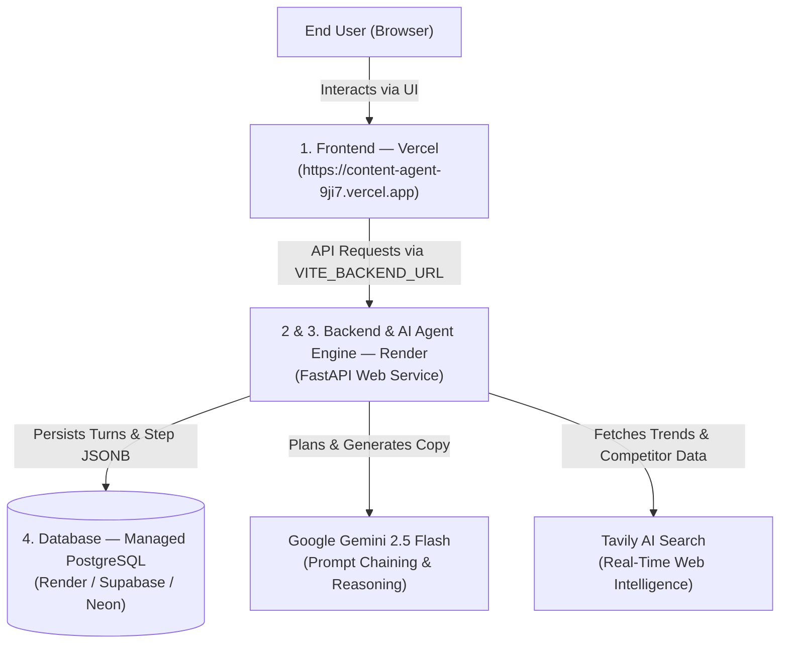

# ContentFlow AI — Autonomous Content Creation Studio 🚀

[](https://content-agent-9ji7.vercel.app/)
[](https://render.com)
[](https://fastapi.tiangolo.com/)
[](https://react.dev/)
[](https://www.postgresql.org/)
[](https://ai.google.dev/)
[](https://www.docker.com/)

An end-to-end autonomous AI Content Creation Studio that plans, researches, generates, evaluates, and refines high-converting, platform-tailored marketing campaigns with **Persistent PostgreSQL Conversation Memory**.

---

## 🌐 Live Application & Links

- 🚀 **Live Production Web App:** [https://content-agent-9ji7.vercel.app/](https://content-agent-9ji7.vercel.app/)
- 📦 **GitHub Repository:** [https://github.com/Yafet1223/Content-Agent](https://github.com/Yafet1223/Content-Agent)
- 📖 **Production Deployment Guide:** [DEPLOYMENT.md](DEPLOYMENT.md)

---

## ⚡ What is ContentFlow AI?

ContentFlow AI solves the generic content problem. Rather than acting as a one-shot chatbot, it functions as an enterprise multi-agent workflow:

1. **Strategic Planning:** Analyzes audience psychology, brand tone, content goals, and optimal scheduling.
2. **Live Market & Trend Research:** Queries the live web using Tavily AI to uncover competitor hooks, audience questions, and current trends.
3. **Platform-Tailored Content Generation:** Drafts native copy specifically engineered for TikTok (beat sheets & visual actions), LinkedIn (thought leadership frameworks), X/Twitter (viral hooks & threads), Instagram (visual carousels), Blogs, or Paid Ads.
4. **Automated Quality & Policy Evaluator:** Scores the output across relevance, engagement, and platform compliance.
5. **Creator & Publisher Action Kit:** Delivers ready-to-use hooks, hashtag stacks, visual shoot instructions, and publishing protocols.
6. **Persistent Conversation Memory:** Powered by PostgreSQL with native `JSONB`, allowing users to return anytime, switch sessions, and make continuous follow-up refinements without losing context.

---

## 🏛️ System Architecture



---

## 🚀 Key Features

- **🧠 Persistent Conversation Memory:** SQLite & PostgreSQL with native `JSONB`. All prompts, agent responses, and 5-stage metadata survive page reloads and browser restarts.
- **🔄 Multi-Turn Follow-Ups:** Ask the agent to refine outputs (*"Make a punchy 15-second version for exam week"*) while retaining prior context.
- **🎯 6 Native Content Formats:**
  - **TikTok / Reels / Shorts:** Timed visual b-roll cues, on-screen text overlays, spoken voiceover, audio track guidance.
  - **LinkedIn Posts:** Authority-building hooks, skimmable paragraph structures, actionable lessons, strategic engagement questions.
  - **X / Twitter Threads:** Scroll-stopping hooks, numbered insights, retweet magnets.
  - **Instagram Posts & Carousels:** Slide-by-slide visual concepts, caption storytelling, clean hashtag clouds.
  - **Blog Articles:** SEO-structured headers (H1/H2/H3), introduction hooks, comprehensive takeaways.
  - **Paid Ads Copy:** PAS (Problem-Agitate-Solution) & AIDA frameworks, value propositions, high-converting CTAs.
- **🔍 Live Web Intelligence:** Real-time web trend discovery via Tavily AI Search.
- **🎨 Modern SaaS Studio UI:** Built with React 19, Lucide icons, glassmorphic styling, analytics dashboards, and campaign project workspaces.
- **🐳 Full Docker Containerization:** Zero-configuration local startup using Docker Compose.

---

## 🗂️ Project Structure

```
Content-Agent/
├── docker-compose.yml          # Full-stack Docker orchestration (DB + API + Nginx)
├── .dockerignore               # Container build context filters
├── .env.example                # Environment variables template
├── .gitignore                  # Production-grade git ignore (protects secrets & DB)
├── render.yaml                 # 1-click Render Blueprint specification
├── vercel.json                 # Vercel SPA routing configuration
├── DEPLOYMENT.md               # Step-by-step production deployment guide
│
├── Backend/                    # FastAPI Backend Service
│   ├── main.py                 # API router, CORS middleware, conversation endpoints
│   ├── requirements.txt        # Python backend dependencies
│   └── Dockerfile              # Python 3.11-slim container spec
│
├── Database/                   # Database Engine & Persistence Layer
│   ├── db.py                   # PostgreSQL connection pool with JSONB & SQLite fallback
│   └── __init__.py
│
├── Frontend/my-react-app/      # Modern React 19 Frontend
│   ├── src/                    # Components (Dashboard, Projects, Calendar, Analytics)
│   ├── package.json            # Vite + React 19 + Lucide dependencies
│   ├── nginx.conf              # Production Nginx reverse proxy configuration
│   ├── Dockerfile              # Multi-stage production container
│   └── vercel.json             # Vercel client-side routing rewrites
│
├── workflow.py                 # 5-Stage Agentic Workflow Pipeline
├── router.py                   # Platform classification logic
├── config.py                   # Environment configuration loader
└── models.py                   # Pydantic schemas
```

---

## 🛠️ Quickstart: Running Locally

### Option 1: Run with Docker Compose (Recommended)

Make sure Docker Desktop is running, then run from the project root:

```bash
# 1. Clone the repository
git clone https://github.com/Yafet1223/Content-Agent.git
cd Content-Agent

# 2. Configure your environment variables
cp .env.example .env
# Edit .env and paste your GEMINI_API_KEY and TAVILY_API_KEY

# 3. Start the entire stack (Database + Backend + Frontend)
docker compose up --build -d

# 4. Access the apps:
# Frontend UI: http://localhost:5173
# FastAPI Docs: http://localhost:8000/docs
# PostgreSQL: localhost:5432
```

---

### Option 2: Run Without Docker (Local Dev)

#### 1. Setup Backend:
```bash
# Install dependencies
pip install -r Backend/requirements.txt

# Configure .env with your keys
cp .env.example .env

# Run FastAPI backend server
cd Backend
python main.py
# Server runs on http://127.0.0.1:8000
```

#### 2. Setup Frontend:
```bash
# In a new terminal:
cd Frontend/my-react-app

# Install npm dependencies
npm install

# Start Vite development server
npm run dev
# Frontend runs on http://localhost:5173
```

---

## ☁️ Production Deployment

ContentFlow AI is engineered for seamless cloud deployment:

| Layer | Platform | Setup |
| :--- | :--- | :--- |
| **Frontend** | **[Vercel](https://vercel.com/)** | Connect repo, select `Frontend/my-react-app`, set `VITE_BACKEND_URL` |
| **Backend & Agent** | **[Render](https://render.com/)** | 1-click deploy via [`render.yaml`](render.yaml) Blueprint |
| **Database** | **Managed PostgreSQL** | Auto-provisioned by Render or connect external Supabase/Neon URL |

*For complete step-by-step deployment instructions, see [DEPLOYMENT.md](DEPLOYMENT.md).*

---

## 🔑 Environment Variables

| Variable | Description | Required |
| :--- | :--- | :--- |
| `GEMINI_API_KEY` | Google Gemini API Key for planning & copywriting | **Yes** |
| `TAVILY_API_KEY` | Tavily Search Key for live trend analysis | **Yes** |
| `DATABASE_URL` | PostgreSQL connection string (`postgresql://...`) | Optional (defaults to local) |
| `GEMINI_MODEL` | LLM model name (defaults to `gemini-2.5-flash`) | Optional |
| `VITE_BACKEND_URL` | Frontend pointer to Render backend API | For Vercel production |

---

## 📄 License

MIT License © 2026 ContentFlow AI. Built with ❤️ for content creators and marketers worldwide.
